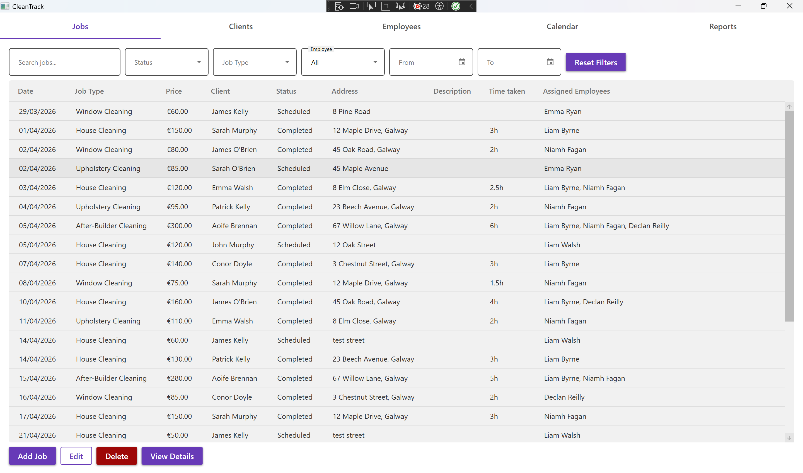
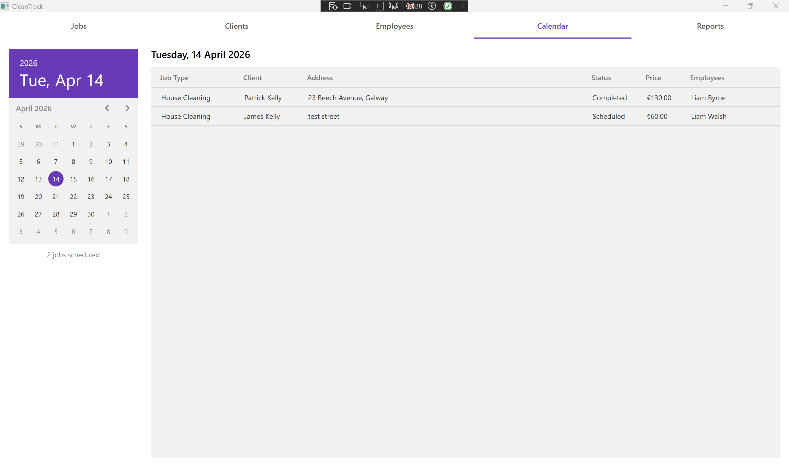
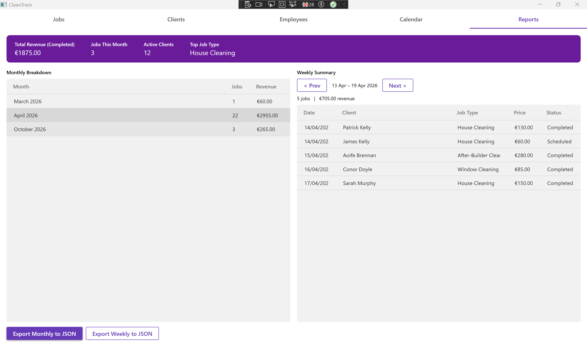

# CleanTrack

A Windows desktop app for managing a small cleaning business: clients, employees, jobs, scheduling and revenue reports in one place.

Built as my Object-Oriented Design project in second year of BSc Software Development at ATU Sligo. The idea came from running my own cleaning business, where I was tracking bookings and staff across notes and spreadsheets.

## Features

- **Jobs:** book, edit and cancel jobs, assign one or more employees, and track status (Booked / Completed / Cancelled), price, address and time taken
- **Clients:** manage client records, including address and Eircode, and see each client's job history
- **Employees:** manage staff with roles (cleaner, supervisor, manager) and active/inactive status
- **Calendar:** view upcoming jobs by date
- **Reports:** monthly revenue and job counts, a weekly summary and headline stat cards
- **Search and filtering** on every list

| Calendar | Reports |
|---|---|
|  |  |

## Tech stack

- **C# / .NET Framework 4.7.2**
- **WPF** with **Material Design in XAML** for the UI
- **Entity Framework 6** (code-first) with **SQL Server Express / LocalDB**
- **MSTest** for unit testing

## Design

- `Client` and `Employee` inherit from an abstract `Person` base class holding the shared contact details. EF is configured to ignore `Person`, so each subclass keeps its own table.
- A `Job` belongs to one `Client` and can have many `Employees` (a many-to-many relationship managed by EF).
- `Job` implements `IComparable<Job>` so job lists sort chronologically.
- `MainWindow` is split into partial classes by area (`Jobs`, `Clients`, `Employees`, `Calendar`, `Reports`) to keep each file focused.
- A separate `DataManagement` console project seeds the database with sample data.

## Running it

1. Open `CleanTrack.sln` in Visual Studio 2022 (Windows).
2. Check the connection string in `CleanTrack/App.config`. It points to `localhost\SQLEXPRESS` by default; switch to the commented-out `(localdb)\MSSQLLocalDB` string if you're using LocalDB.
3. Restore NuGet packages and build.
4. Optional: run the `DataManagement` project once to load sample clients, employees and jobs.
5. Set `CleanTrack` as the startup project and run.

## Tests

Unit tests for the `Job` class (date ordering, sorting and default values) are in `CleanTrack.Tests`. Run them from Visual Studio's Test Explorer.

## What I'd improve next

- Move to an MVVM structure so the UI logic can be unit tested
- Replace the status strings with an enum
- Add input validation on the add/edit forms
- Expand test coverage beyond the `Job` class
